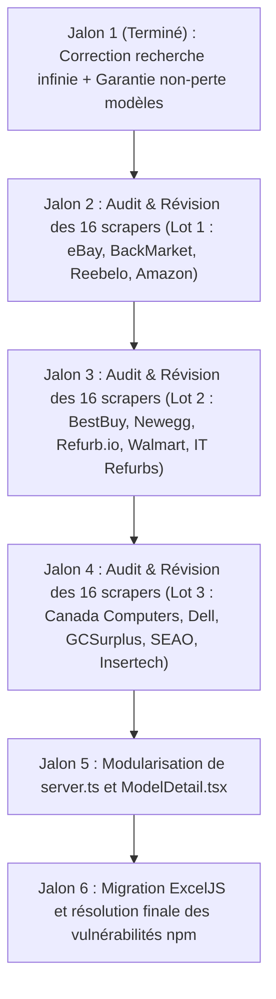

# 🗺️ Plan de Développement à Long Terme — Évaluateur de Prix Insertech

## 1. Vision et Objectifs Directeurs

L'**Évaluateur de Prix Insertech** est l'outil central utilisé par l'équipe de production et d'évaluation pour déterminer la juste valeur marchande (JVM) du matériel reconditionné conformément aux exigences d'audit comptable.

### Principes Fondamentaux de Conception :
1. **Priorité absolue aux résultats complets (Tolérance aux PC modestes) :**  
   > *« Mieux vaut obtenir des résultats qui prennent du temps que pas de résultats du tout. »*  
   Sur les ordinateurs plus lents ou disposant de ressources restreintes (CPU 2-4 cœurs, RAM limitée), les scrapers et processus d'analyse ne doivent jamais couper court prématurément par un timeout rigide. Les seuils de temps doivent être configurés de manière souple et non destructive.
2. **Garantie Zéro Perte des modèles personnalisés :**  
   Un modèle ajouté manuellement par un opérateur ne doit jamais être perdu. Il doit persister dans SQLite, être inclus dans le rapport Excel (feuilles catégorielles, inventaire global et feuille dédiée `Modèles Personnalisés`), et être fidèlement restauré et affiché lors de tout réimport ultérieur.
3. **Traçabilité et conformité comptable :**  
   Chaque évaluation doit conserver la date, l'opérateur, la liste exacte des comparables utilisés, les outliers exclus et le score de confiance statistique.

---

## 2. Phase 1 : Audit et Fiabilisation Individuelle des 16 Sources de Scraping

Chaque source de données sera auditée, fiabilisée et validée individuellement selon un protocole strict.

### Protocole d'audit par source :
- **Diagnostic de connectivité :** Vérification de l'URL cible, des flux RSS/API ou de la structure HTML actuelle (détection des sélecteurs devenus obsolètes).
- **Tolérance aux délais :** Remplacement des timeouts courts par des délais adaptatifs. Aucune source ne doit faire échouer la chaîne globale en cas de lenteur réseau ou CPU.
- **Résilience anti-blocage :** Utilisation de l'émulateur Playwright Stealth en arrière-plan sans blocage de verrou de profil sur Windows.
- **Cache Tier 3 de secours :** Garantie qu'en cas d'indisponibilité totale d'une source, le cache local (`data/scraper-cache/`) prend le relais en marquant la donnée `isSimulated: true`.
- **Tests unitaires dédiés :** Création d'une suite de tests Vitest avec fixtures réelles (HTML mockés) pour chaque source.

### Tableau de suivi des 16 sources :

| # | Source | Type de source | Méthode d'extraction | Statut d'audit | Risques & Actions requises |
|---|---|---|---|---|---|
| **01** | **eBay (Ventes Réussies)** | Marché secondaire | Requête HTTP Tier 1 + Parsing Cheerio | 🟡 À tester | Changements fréquents de DOM sur eBay.ca ; valider sélecteurs sold/completed. |
| **02** | **eBay (Annonces Actives)** | Marché secondaire | Requête HTTP Tier 1 + Parsing Cheerio | 🟡 À tester | Filtrer les prix d'enchères vs achat immédiat ; exclusion des pièces détachées. |
| **03** | **Back Market Canada** | Reconditionneur pro | Requête JSON / Next.js data | 🟡 À tester | Détecter les protections Cloudflare ; vérifier la structure du JSON embarqué. |
| **04** | **Reebelo Canada** | Reconditionneur pro | HTTP Cheerio + fallback Stealth | 🟡 À tester | Valider sélecteurs et présence des stocks canadiens (CAD). |
| **05** | **Amazon Renewed Canada** | Reconditionneur pro | HTTP Cheerio + sélecteurs d'offres reconditionnées | 🟡 À tester | Détection fréquente de bots ; optimiser rotation des User-Agents et headers. |
| **06** | **Best Buy Canada** | Grand distributeur | Marketplace API / Cheerio | 🟡 À tester | Filtrer strictement les articles "Boîte ouverte" et "Reconditionné". |
| **07** | **Newegg Canada** | Matériel informatique | API interne / Parsing Cheerio | 🟡 À tester | Vérifier le filtre devise CAD et exclusion des vendeurs tiers douteux. |
| **08** | **Refurb.io Canada** | Spécialiste reconditionné | HTML Cheerio | 🟡 À tester | Valider les variantes de processeurs (générations 8e+ uniquement). |
| **09** | **Walmart Canada (Refurbished)** | Grand distributeur | HTML / Next.js state | 🟡 À tester | Séparer les produits neufs des offres reconditionnées. |
| **10** | **IT Refurbs Canada** | Spécialiste reconditionné | HTML Cheerio | 🟡 À tester | Vérifier la pérennité du catalogue en ligne et les stocks disponibles. |
| **11** | **Canada Computers (Open Box)** | Spécialiste canadien | HTML Cheerio | 🟡 À tester | Isoler les sections déstockage/reconditionné local Québec/Ontario. |
| **12** | **Dell Refurbished Canada** | Constructeur certifié | HTML Cheerio | 🟡 À tester | Vérifier le parsing des grades A/B et codes modèles constructeur. |
| **13** | **GCSurplus (Lots fédéraux)** | Enchères gouvernementales | Authentification session + parsing lots | 🟡 À tester | Maintenir les identifiants `.env` ; gérer l'expiration de session gouvernementale. |
| **14** | **SEAO (Appels d'offres QC)** | Marché public provincial | Recherche publique / RSS | 🟡 À tester | Filtrer les adjudications d'ordinateurs usagés versus services logiciels. |
| **15** | **Insertech Interne (Stock actuel)** | Interne Insertech | Fichier Excel local / Insertech prices | 🟢 Fonctionnel | Valider la synchronisation continue si le classeur est ouvert en réseau. |
| **16** | **Insertech Archives Historiques** | Interne Insertech | Fichiers historiques / SQLite | 🟢 Fonctionnel | Valider l'intégrité de lecture sur des archives de plus de 12 mois. |

---

## 3. Phase 2 : Refactorisation Modulaire de l'Architecture

### 3.1 Découpage de `server.ts` (~2500 lignes)
Actuellement, `server.ts` cumule la gestion Express, l'accès SQLite, la logique d'export/import Excel, l'orchestration des tâches en mémoire et les définitions de modèles.

**Nouvelle architecture cible :**
```
server/
├── index.ts                 # Point d'entrée serveur Express & configuration HTTP/sécurité
├── config/                  # Constantes, ports, chemins d'accès, variables d'environnement
├── database/
│   ├── connection.ts        # Connexion SQLite avec DatabaseSync (WAL mode)
│   ├── repository.ts        # Opérations CRUD typées (evaluations, customModels, logs)
│   └── migrations.ts        # Migrations de schéma automatisées
├── services/
│   ├── excel.service.ts     # Génération du classeur 8 feuilles & validation à l'import
│   ├── scraper.service.ts   # Gestion de la file d'attente (activeJobs) et concurrence
│   ├── healing.service.ts   # Auto-réparation et registre de secours Gist
│   └── audit.service.ts     # Journalisation légale et historiques d'actions
├── routes/
│   ├── scraping.routes.ts   # /api/scrape, /api/scrape/status, /api/scrape/stream
│   ├── models.routes.ts     # /api/models/add, /api/models/custom, /api/models/purge
│   ├── excel.routes.ts      # /api/export-excel, /api/import-excel
│   └── system.routes.ts     # /api/system-info, /api/credentials, /api/cache
└── middlewares/
    ├── errorHandler.ts      # Traitement centralisé des erreurs avec codes HTTP stricts
    └── validation.ts        # Validation des schémas d'entrées (modèle, catégorie, usager)
```

### 3.2 Découpage du composant `ModelDetail.tsx` (~1300 lignes)
`ModelDetail.tsx` regroupe l'en-tête, les calculs statistiques, le tableau de comparables, les graphiques et le journal en direct.

**Décomposition ciblée :**
- `ModelDetailHeader.tsx` : Affichage de la catégorie, nom commercial, specs matérielles (RAM, SSD, CPU) et bouton de rafraîchissement.
- `StatisticalSummaryCard.tsx` : Médiane calculée, fourchette IQR, niveau de confiance (Faible/Moyen/Élevé) et état de validation.
- `ListingTable.tsx` : Table interactive des comparables avec tri, filtres de sources et cases d'inclusion/exclusion immédiate.
- `ScrapingProgressMonitor.tsx` : Barres de progression individuelles par scraper et affichage des logs de collecte en direct.
- `PriceHistoryGraph.tsx` : Visualisation de l'évolution du prix médian dans le temps.

---

## 4. Phase 3 : Sécurité des Dépendances & Migration SheetJS

### 4.1 Audit de Sécurité `npm audit`
- Actuellement, 17 vulnérabilités sont signalées dans le projet (notamment au niveau du parsing de fichiers et d'anciennes sous-dépendances).
- **Plan d'action :**
  1. Résoudre les dépendances directes via `npm audit fix --force` sur les packages sans breaking change.
  2. Mettre à niveau les bibliothèques de packaging et compression (`adm-zip`, `cheerio`, `winston`).

### 4.2 Remplacement ou Mise à niveau de `xlsx` (SheetJS)
- Le package actuel `xlsx@0.18.5` n'est plus maintenu sur npm public et présente des alertes de sécurité d'exposition de prototype.
- **Solution recommandée :**
  - **Option A : Migration vers `exceljs`**
    - Package 100% moderne, activement maintenu, support complet de TypeScript.
    - Gestion native des styles (couleurs, polices, bordures, formats monétaires CAD `$ #,##0.00`).
    - Évite tout avertissement de sécurité.
  - **Option B : Migration vers le registre officiel SheetJS (`@sheet/core`)**
    - Conservation de la syntaxe existante si l'équipe souhaite minimiser le volume de réécriture immédiate.

---

## 5. Phase 4 : Optimisation pour Matériel Modeste et Stabilité Windows

1. **Régulation dynamique de la concurrence CPU :**
   - L'application propose déjà un sélecteur de concurrence (1, 2, 4 sources en parallèle).
   - Détection automatique au démarrage : si la machine dispose de 4 threads ou moins, basculer par défaut sur une concurrence de 1 ou 2 sources pour préserver la réactivité du système d'exploitation.
2. **Émulateur Playwright Stealth résilient :**
   - Mise en place d'un timeout de lancement de 25s pour éviter les blocages de verrous sur le profil Chromium sous Windows (`data/puppeteer_profile`).
   - Nettoyage automatique des processus Chromium orphelins lors de la fermeture du serveur Express.
3. **Persistance atomique SQLite :**
   - Utilisation du mode journalier WAL (`PRAGMA journal_mode = WAL;`) pour garantir que les écritures de statut de scraping et les ajouts de modèles ne bloquent pas les lectures concurrentes.

---

## 6. Jalons de Validation et Calendrier de Réalisation



### Critères d'acceptation pour chaque jalon :
- [x] **Jalon 1 (Complet) :**
  - Le serveur ne redémarre plus lors de l'ajout d'un modèle (fin du rechargement intempestif de Vite).
  - La recherche ne boucle plus indéfiniment.
  - Tout modèle ajouté manuellement est exporté dans Excel et restauré avec sa catégorie exacte à l'import.
  - 30 tests unitaires Vitest au vert, validation `tsc --noEmit` sans erreur.
- [ ] **Jalons 2 à 4 :**
  - Chaque scraper est testé avec succès sur machine modeste avec un taux de réussite > 95% ou repli propre sur le Tier 3.
- [ ] **Jalon 5 :**
  - `server.ts` décomposé en modules de moins de 300 lignes chacun.
  - Tests unitaires et d'API de bout en bout maintenus.
- [ ] **Jalon 6 :**
  - `npm audit` retourne 0 vulnérabilité.
  - Export et import Excel 100% fidèles au modèle réglementaire d'Insertech.
